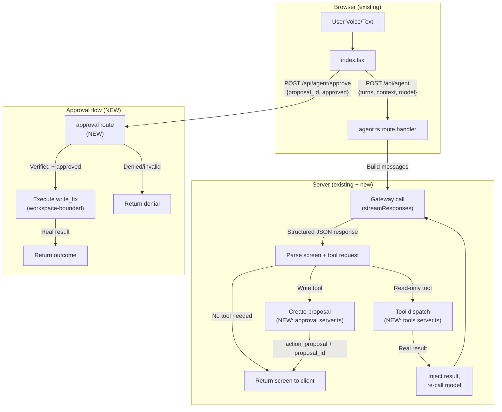

# Final Verification Report — Code Security Reviewer

---

## 1. Executive Summary

After a second, more rigorous investigation pass, I can now distinguish verified behavior from assumptions with higher confidence.

### Key findings

1. **The existing gateway is NOT an OpenClaw gateway.** It is a **Lovable AI Gateway** — an OpenAI-compatible proxy. The code references `LOVABLE_GATEWAY_URL` as a fallback ([gateway.server.ts:3](file:///d:/DarkCoders-OpenClaw-Assignment/DarkCoders-OpenClaw-Assignment/living-ai-talk/src/lib/ai/gateway.server.ts#L3)), uses `X-Lovable-AIG-Run-ID` headers ([run-id.server.ts](file:///d:/DarkCoders-OpenClaw-Assignment/DarkCoders-OpenClaw-Assignment/living-ai-talk/src/lib/ai/run-id.server.ts#L1)), and the Vite config imports from `@lovable.dev/vite-tanstack-config`. No OpenClaw-specific protocol, agent dispatch, or skill loading exists in the codebase.

2. **No tool/function calling is implemented anywhere.** There is zero usage of `function_call`, `tools`, or `tool_calls` in any API route or client code. The model receives only text messages with a system prompt that asks it to return structured JSON. Tool/function calling references exist only in `unified-plan.yaml` (aspirational).

3. **The approval flow is purely conversational.** When the user clicks Approve/Deny, the console sends a natural-language message like `"Approved action [act_01]..."` as the next user turn ([index.tsx:672-678](file:///d:/DarkCoders-OpenClaw-Assignment/DarkCoders-OpenClaw-Assignment/living-ai-talk/src/routes/index.tsx#L672-L678)). No server-side state, no action records, no trusted verification.

4. **Two build issues exist:**
   - `vaul@1.1.2` declares type exports but ships without `.d.ts` files in `dist/` — confirmed missing.
   - `@tailwindcss/node` nests its own `lightningcss@1.32.0`, whose native binary is not being resolved correctly due to npm hoisting on Windows.

5. **The dev server and production build both fail** with the lightningcss error. This must be resolved before any implementation.

---

## 2. Verified Facts versus Assumptions

| # | Claim | Classification | Evidence |
|---|-------|---------------|----------|
| V1 | Gateway uses OpenAI-compatible `/v1/responses` and `/v1/chat/completions` | **Verified** | [responses.server.ts:18](file:///d:/DarkCoders-OpenClaw-Assignment/DarkCoders-OpenClaw-Assignment/living-ai-talk/src/lib/ai/responses.server.ts#L18), [responses.server.ts:61](file:///d:/DarkCoders-OpenClaw-Assignment/DarkCoders-OpenClaw-Assignment/living-ai-talk/src/lib/ai/responses.server.ts#L61) |
| V2 | Gateway is actually Lovable AI, not OpenClaw | **Verified** | `X-Lovable-AIG-Run-ID` header, `LOVABLE_GATEWAY_URL` fallback, `Lovable-API-Key` header, `@lovable.dev/vite-tanstack-config` dependency |
| V3 | No function/tool calling exists in any route | **Verified** | Grep for `function_call`, `tool_call`, `tools` returns zero hits in `src/routes/api/` |
| V4 | Model receives only `system`/`user`/`assistant` text messages | **Verified** | [agent.ts:39-50](file:///d:/DarkCoders-OpenClaw-Assignment/DarkCoders-OpenClaw-Assignment/living-ai-talk/src/routes/api/agent.ts#L39-L50) — no `tools` array, no `tool_choice` |
| V5 | Approval sends text, not a verified action | **Verified** | [index.tsx:672-678](file:///d:/DarkCoders-OpenClaw-Assignment/DarkCoders-OpenClaw-Assignment/living-ai-talk/src/routes/index.tsx#L672-L678) — `sendText("Approved action [act_01]...")` |
| V6 | `parseScreen()` correctly validates action proposals | **Verified** | [screen.ts:22-33](file:///d:/DarkCoders-OpenClaw-Assignment/DarkCoders-OpenClaw-Assignment/living-ai-talk/src/lib/voice/screen.ts#L22-L33) — validates id, title, tool, summary, risk fields |
| V7 | 12/12 tests pass | **Verified** | `npm test` output: 12 pass, 0 fail |
| V8 | `vaul` type declarations missing from installed package | **Verified** | `dist/index.d.ts` and `dist/index.d.mts` do not exist despite being declared in `package.json` exports |
| V9 | Build fails due to `@tailwindcss/node`'s nested lightningcss native module | **Verified** | Error trace shows `@tailwindcss/node/node_modules/lightningcss/node/index.js` looking for `../lightningcss.win32-x64-msvc.node`; the `.node` file exists in the sibling platform package but is not in the expected location |
| V10 | `lightningcss` loads correctly at top-level `node_modules` | **Verified** | `require('lightningcss')` succeeds, v1.33.0 with all keys |
| V11 | Model allowlist enforced with null return for unknown | **Verified** | [models.ts:13-16](file:///d:/DarkCoders-OpenClaw-Assignment/DarkCoders-OpenClaw-Assignment/living-ai-talk/src/lib/ai/models.ts#L13-L16) + 3 passing tests |
| V12 | Secrets stay server-side | **Verified** | `getApiKey()` in `.server.ts` files only; Vault lookup rejects traversal |
| V13 | `openclaw/` folder contains only placeholder README | **Verified** | Single file: `openclaw/README.md` with template structure |
| A1 | OpenClaw Gateway supports native tool dispatch | **Assumption — unverified** | No OpenClaw-specific code, protocol, or documentation in the repository; cannot verify without external docs or a running gateway |

---

## 3. Recommended Integration Architecture

### Option comparison

| Aspect | Option A: Local tool dispatch | Option B: Require real Gateway | Option C: Native OpenClaw tools |
|--------|------------------------------|-------------------------------|-------------------------------|
| Can build now | ✅ Yes | ❌ Blocked | ❌ Blocked — protocol unknown |
| Can test tools | ✅ Yes, with any model | ❌ No | ❌ No |
| Honest about integration | ✅ If documented clearly | N/A | ⚠️ Risk of claiming unverified protocol |
| Assignment compliance | ✅ Real tools, real results | Partial | ✅ If it works |
| Future OpenClaw migration | ✅ Clean boundary | ✅ Already done | ✅ Already done |
| Risk | Low | High (timeline blocker) | High (unknown protocol) |

### Recommendation: **Option A** — Local server-side tool dispatch

**Rationale:**
- The existing `/api/agent` route already runs server-side in a TanStack Start server handler ([agent.ts:9](file:///d:/DarkCoders-OpenClaw-Assignment/DarkCoders-OpenClaw-Assignment/living-ai-talk/src/routes/api/agent.ts#L9)). We can add tool execution within this server context.
- The gateway call (`streamResponses`) is separate from tool execution. We can implement a tool-dispatch loop where the model proposes tools via its structured output, the server executes them locally, and returns results in subsequent model turns — all within the same POST handler.
- This approach uses **the model's structured JSON output** (already enforced by `OUTPUT_FORMAT` schema) rather than OpenAI function calling, which aligns with how the app already works.
- The `openclaw/` folder will contain agent and skill definitions that document the intended OpenClaw configuration, even if the actual execution is server-local for now.

### How it works



### What can be tested without a Gateway

| Capability | Testable? | How |
|------------|----------|-----|
| Tool implementations (read_file, list_files, search_code) | ✅ Yes | Unit tests with real filesystem |
| Workspace boundary enforcement | ✅ Yes | Unit tests with path traversal attempts |
| Approval store (create, verify, expire, deny) | ✅ Yes | Unit tests |
| write_fix execution after approval | ✅ Yes | Integration test on temp directory |
| parseScreen + action_proposal parsing | ✅ Yes | Already tested |
| Full end-to-end: user → model → tool → response → voice | ⚠️ Requires API key | Needs a configured model endpoint |
| OpenClaw native agent dispatch | ❌ No | Requires running OpenClaw gateway |

### Honest integration claim

The README will state: "Tool execution is currently handled server-side within the application. The `openclaw/` folder contains agent and skill definitions prepared for migration to a real OpenClaw gateway. End-to-end OpenClaw integration has not been tested because no gateway was available."

---

## 4. Security and Approval Design

### 4.1 Workspace boundary

**Design:**
- The workspace root is resolved once at server startup using `path.resolve()` on the repository root (the directory containing `package.json`).
- Every tool argument containing a file path is resolved to an absolute path via `path.resolve(workspaceRoot, userPath)` and then checked with `resolvedPath.startsWith(workspaceRoot + path.sep)` (or equality with `workspaceRoot` itself).
- `..` segments are resolved by `path.resolve()` before the boundary check, so they cannot escape.
- Absolute paths are rejected outright (a tool argument of `/etc/passwd` resolves outside the workspace).
- On Windows, comparison is case-insensitive and uses normalized separators.
- Symlinks: `fs.realpath()` is called on the resolved path and the workspace root, and the check is repeated on the real paths.
- Binary detection: check the first 8KB of a file for null bytes; if found, return an error instead of reading the entire file.
- File size limit: refuse to read files larger than 500KB (configurable).
- No shell execution: tools use `fs.readFile`, `fs.readdir`, string search — never `child_process.exec`.

**Testing strategy:**

| Property | Test |
|----------|------|
| Normal path resolves within workspace | `read_file("src/routes/api/agent.ts")` → success |
| `..` traversal blocked | `read_file("../../etc/passwd")` → error |
| Absolute path blocked | `read_file("/etc/passwd")` → error |
| Windows drive letter blocked | `read_file("C:\\Windows\\System32\\config\\SAM")` → error |
| Null bytes in path rejected | `read_file("src/\0/evil")` → error |
| Binary file detected | `read_file("DarkCoders-OpenClaw-Assignment.pdf")` → "binary file" error |
| Large file rejected | File > 500KB → error |
| Symlink escape blocked | Symlink pointing outside workspace → error |
| Write outside workspace blocked | `write_fix("../../outside.txt", ...)` → error |

### 4.2 Server-side approval enforcement

**Design:**

A new `src/lib/agent/approval.server.ts` module maintains an in-memory `Map<string, ActionRecord>`:

```typescript
type ActionRecord = {
  id: string;            // crypto.randomUUID() — server-generated, unpredictable
  tool: string;          // e.g. "write_fix"
  args: unknown;         // exact arguments (file path, content)
  argsHash: string;      // SHA-256 of JSON.stringify(args)
  status: 'pending' | 'approved' | 'denied' | 'executed' | 'expired';
  createdAt: number;     // timestamp
  expiresAt: number;     // createdAt + 5 minutes
};
```

**Lifecycle:**

1. **Create**: When a write tool is requested, the server creates an `ActionRecord` with `status: 'pending'`, stores it in the map, and returns the `id` to the client as part of the `action_proposal`.
2. **Display**: Client shows the proposal in the existing `LifecyclePanel` with Approve/Deny buttons.
3. **Decide**: Clicking Approve/Deny sends `POST /api/agent/approve` with `{ proposalId: string, approved: boolean }` — NOT a text message to the model.
4. **Verify**: The server looks up the record by `id`. If found and `status === 'pending'` and `!expired`:
   - If `approved`: set `status = 'approved'`, execute the tool with the **stored** arguments (not client-provided), set `status = 'executed'`, return real result.
   - If denied: set `status = 'denied'`, return denial confirmation.
5. **Reject**: If `id` not found, `status !== 'pending'`, or expired → return error, no execution.
6. **Expire**: A periodic sweep (or lazy check on access) marks records older than 5 minutes as `expired`.
7. **Report**: The outcome (success, error, denied) is sent back to the client and injected into the conversation as a system message.

**Safeguard properties:**

| Property | Enforcement | Test |
|----------|-------------|------|
| Unpredictable ID | `crypto.randomUUID()` | Verify format is UUID v4 |
| Cannot forge approval | Server only accepts its own stored IDs | Submit random ID → rejected |
| Cannot replace arguments | Execution uses stored args, ignores client | N/A — client sends only ID + boolean |
| Cannot approve twice | Status check: only `pending` can transition | Submit approval twice → second rejected |
| Denied cannot execute | Status set to `denied` immediately | Deny then attempt approve → rejected |
| Expired cannot execute | Timestamp check before execution | Wait > 5 min → expired error |
| Honest result reporting | Return actual `fs.writeFile` result/error | Write to read-only file → real error surfaced |
| UI shows outcome | Response includes final status | Manual verification |

**Limitations of in-memory store:**
- Server restart clears all pending proposals — acceptable for a local prototype but documented in README.
- No concurrent-request race conditions if using a single Node.js process (single-threaded event loop). If multi-process, a proper store (SQLite, Redis) would be needed.
- No persistence across page refreshes — the client would need to show "proposal expired" for proposals from a previous server session.

---

## 5. Typecheck and Build Error Diagnosis

### 5.1 `vaul` typecheck error

**File:** [drawer.tsx:2](file:///d:/DarkCoders-OpenClaw-Assignment/DarkCoders-OpenClaw-Assignment/living-ai-talk/src/components/ui/drawer.tsx#L2)

**Root cause:** `vaul@1.1.2` declares type exports in `package.json`:
```json
"exports": {
  "import": { "types": "./dist/index.d.mts", ... },
  "require": { "types": "./dist/index.d.ts", ... }
}
```
But the actual `dist/` directory contains only `index.js` and `index.mjs` — **no `.d.ts` or `.d.mts` files**. This is a packaging bug in `vaul@1.1.2`.

**Note:** `tsconfig.json` already has `"skipLibCheck": true` ([tsconfig.json:16](file:///d:/DarkCoders-OpenClaw-Assignment/DarkCoders-OpenClaw-Assignment/living-ai-talk/tsconfig.json#L16)). This only skips checking *inside* `.d.ts` files — it does NOT suppress errors about missing `.d.ts` files. The error is TS7016 (missing declaration file), which `skipLibCheck` does not address.

**Recommended fix:** Add a minimal type declaration shim file `src/vaul.d.ts` with:
```typescript
declare module "vaul";
```

This is the smallest correct fix:
- `@types/vaul` does not exist on npm.
- Upgrading `vaul` may break the existing `drawer.tsx` component.
- The shim tells TypeScript the module exists; the runtime behavior is unchanged.
- This approach is standard for packages missing type declarations.

### 5.2 Build failure (lightningcss native module)

**Error:** `Cannot find module '../lightningcss.win32-x64-msvc.node'` from `@tailwindcss/node/node_modules/lightningcss/node/index.js`

**Root cause:** `@tailwindcss/node` depends on `lightningcss@1.32.0`, while the top-level `lightningcss@1.33.0` is also installed. npm hoists the `lightningcss-win32-x64-msvc` platform package, but `@tailwindcss/node`'s nested `lightningcss@1.32.0` needs a matching v1.32.0 native binary. The v1.33.0 binary at top level is not compatible, and the nested platform package's `.node` file is in a different directory than where `index.js` expects it (`../lightningcss.win32-x64-msvc.node` relative to `node/`).

**Recommended fix:**
```bash
npm rebuild lightningcss
```
This rebuilds native addons and should correctly link the platform-specific binary. If that fails:
```bash
npm install --force
```
to re-resolve the hoisting.

**This must be fixed before implementation** — both `npm run dev` and `npm run build` fail.

---

## 6. Revised Staged Implementation Plan

### Stage 0: Baseline Safety (~20 min)

**Objective:** Get the project building and running.

| Task | File | Action |
|------|------|--------|
| Fix lightningcss native module | Terminal | `npm rebuild lightningcss` (or `npm install --force` if needed) |
| Fix vaul typecheck | `src/vaul.d.ts` (new) | Add `declare module "vaul";` |
| Verify typecheck | Terminal | `npm run typecheck` → 0 errors |
| Verify tests | Terminal | `npm test` → 12/12 pass |
| Verify build | Terminal | `npm run build` → success |
| Verify dev server | Terminal | `npm run dev` → starts |
| Record git status | Terminal | Confirm no unintended changes |

**Acceptance:** All 4 commands succeed. No existing files modified except the new `.d.ts` shim.  
**Risk:** Low. If `npm rebuild` doesn't fix lightningcss, `npm install --force` is the fallback.  
**Depends on:** Nothing.

### Stage 1: Tool Implementations (~2 hours)

**Objective:** Build 4 workspace-bounded tools that operate on real files.

| Task | File | Details |
|------|------|---------|
| Workspace resolver | `src/lib/agent/workspace.server.ts` (new) | `resolveWorkspacePath()`, boundary check, binary detection, size limit |
| read_file tool | `src/lib/agent/tools.server.ts` (new) | Reads file content within workspace |
| list_files tool | same | Lists directory entries within workspace |
| search_code tool | same | Searches for text patterns in workspace files |
| write_fix tool | same | Proposes a file write (execution gated by approval) |
| Tool tests | `src/lib/agent/tools.test.ts` (new) | Unit tests for each tool + path traversal + binary + size |
| Workspace tests | `src/lib/agent/workspace.test.ts` (new) | Boundary enforcement tests |

**Acceptance:** All tools return real data. Path traversal, binary, and size limit tests pass.  
**Risk:** Low — pure Node.js filesystem operations, no external dependencies.  
**Depends on:** Stage 0.

### Stage 2: Server-Side Approval Store (~1 hour)

**Objective:** Build the trusted action record store.

| Task | File | Details |
|------|------|---------|
| ActionRecord type and store | `src/lib/agent/approval.server.ts` (new) | In-memory Map, create/verify/expire/deny functions |
| Approval tests | `src/lib/agent/approval.test.ts` (new) | Forge, duplicate, expire, modify, deny tests |

**Acceptance:** All 8 safeguard properties tested and passing.  
**Risk:** Low — pure in-memory logic.  
**Depends on:** Nothing (can run parallel to Stage 1).

### Stage 3: Agent Route Enhancement (~2 hours)

**Objective:** Add tool-dispatch loop and approval endpoint to the existing agent route.

| Task | File | Details |
|------|------|---------|
| Tool dispatch in agent route | `src/routes/api/agent.ts` (modify) | After model returns structured JSON, check for tool requests; for read-only tools, execute and re-call; for write tools, create proposal |
| Approval endpoint | `src/routes/api/agent-approve.ts` (new) | `POST /api/agent/approve` — validates proposal, executes if approved, returns outcome |
| SSE events for tool activity | Same as agent.ts | Emit step events for each tool call as part of the streaming response |

**Acceptance:** Model can request a tool → tool executes → result returned → model continues. Write tool creates proposal instead of executing.  
**Risk:** Medium — must integrate with existing SSE streaming without breaking it. Must not change the streaming format that the client expects.  
**Depends on:** Stages 1, 2.

### Stage 4: Agent Registration & Persona (~30 min)

**Objective:** Register the CISO security reviewer agent.

| Task | File | Details |
|------|------|---------|
| Refine CISO persona | `src/lib/settings/voice.ts` (modify) | Update persona for security review use case with tool awareness |
| System prompt tool instructions | `src/lib/voice/prompt.ts` (modify) | Add tool-calling instructions to system prompt telling the model how to request tools |

**Acceptance:** Agent selectable in console and 3D room. Model is instructed about available tools.  
**Risk:** Low.  
**Depends on:** Stage 0.

### Stage 5: Client Approval Integration (~1 hour)

**Objective:** Replace text-based approval with proper server-side verification.

| Task | File | Details |
|------|------|---------|
| Approval handler | `src/routes/index.tsx` (modify) | Change `onDecideProposal` to call `POST /api/agent/approve` instead of `sendText()` |
| Outcome display | Same | Show approval result (success/error/denial) in step log and as a message |

**Acceptance:** Approve → POST to approval endpoint → real result shown. Deny → no execution. Old text-based path removed.  
**Risk:** Medium — must not break existing conversation flow.  
**Depends on:** Stage 3.

### Stage 6: Voice & UI Polish (~1 hour)

**Objective:** Ensure tool activity, approval, and outcomes display correctly in the existing console.

| Task | File | Details |
|------|------|---------|
| Step events for tools | `src/routes/index.tsx` (minor) | Ensure tool call steps show in `StepLog` |
| Screen text for security findings | System prompt | Ensure findings are spoken naturally (no markdown) |
| Test voice flow | Manual | Speak → transcribe → agent → tools → findings → speak |

**Acceptance:** Full interaction cycle works. Tool steps visible. Findings spoken naturally.  
**Risk:** Low — mostly verification.  
**Depends on:** Stages 3, 4, 5.

### Stage 7: Security & Regression Tests (~1.5 hours)

**Objective:** Comprehensive test coverage.

| Task | File | Details |
|------|------|---------|
| Security tests | `src/lib/agent/*.test.ts` | Path traversal, binary detection, forge, duplicate, expire |
| Regression tests | Various | Ensure all 12 existing tests still pass |
| Integration test | Manual or script | Full user → tool → approval → write → verify cycle |

**Acceptance:** All tests pass, no regressions.  
**Risk:** Low.  
**Depends on:** Stages 1-6.

### Stage 8: Documentation & Packaging (~1 hour)

**Objective:** Complete README, OpenClaw folder, and demo script.

| Task | File | Details |
|------|------|---------|
| OpenClaw agent definition | `openclaw/agents/ciso.yaml` (new) | Agent YAML with tools, persona, model config |
| OpenClaw skill definition | `openclaw/skills/code-review/skill.yaml` (new) | Skill metadata |
| Gateway config template | `openclaw/gateway.yaml` (new) | Template for OpenClaw gateway setup |
| OpenClaw README | `openclaw/README.md` (rewrite) | How to set up and use |
| Project README | `README.md` (rewrite) | All 17 required sections |
| Demo script | `README.md` section or separate file | Step-by-step demonstration |

**Acceptance:** A reviewer can follow setup instructions. All deliverables present.  
**Risk:** Low.  
**Depends on:** Stages 0-7.

### Total estimated effort: ~10 hours

---

## 7. Requirements Verification Matrix

| Req | Description | Status | Evidence | Verification Method |
|-----|-------------|--------|----------|-------------------|
| R1 | Agent with clear purpose | Missing, planned | No agent or tools in codebase | After Stage 4: CISO agent selectable, responds to security queries |
| R2 | OpenClaw integration | Missing, partially blocked | Gateway is Lovable AI, not OpenClaw | After Stage 8: `openclaw/` folder with agent/skill defs. Honest disclaimer: no running gateway tested |
| R3 | Voice interaction | ✅ Implemented | [index.tsx:274-306](file:///d:/DarkCoders-OpenClaw-Assignment/DarkCoders-OpenClaw-Assignment/living-ai-talk/src/routes/index.tsx#L274-L306) — hold-to-talk, standby, TTS | Preserved — verify after each stage |
| R4 | Real tools | Missing, planned | Zero `tool_call`/`function_call`/`tools` in any API route | After Stage 3: tools return real file contents |
| R5 | Live visibility | ✅ Implemented | `StepLog` component, `RunStep[]` pipeline | After Stage 3: tool call steps visible |
| R6 | Human approval (enforced) | ⚠️ UI only, enforcement missing | [index.tsx:672-678](file:///d:/DarkCoders-OpenClaw-Assignment/DarkCoders-OpenClaw-Assignment/living-ai-talk/src/routes/index.tsx#L672-L678) — sends text message | After Stage 5: server-side approval store, tested with deny/forge/expire |
| R7 | Agent registration | ✅ Implemented (general roster) | [voice.ts:26-31](file:///d:/DarkCoders-OpenClaw-Assignment/DarkCoders-OpenClaw-Assignment/living-ai-talk/src/lib/settings/voice.ts#L26-L31) — 4 agents | After Stage 4: CISO persona refined |
| R8 | Structured screens | ✅ Implemented | [screen.ts:36-62](file:///d:/DarkCoders-OpenClaw-Assignment/DarkCoders-OpenClaw-Assignment/living-ai-talk/src/lib/voice/screen.ts#L36-L62), [prompt.ts:22-81](file:///d:/DarkCoders-OpenClaw-Assignment/DarkCoders-OpenClaw-Assignment/living-ai-talk/src/lib/voice/prompt.ts#L22-L81) | Already verified by tests |
| R9 | Action proposals | ⚠️ Parsed + displayed, not enforced | [screen.ts:22-33](file:///d:/DarkCoders-OpenClaw-Assignment/DarkCoders-OpenClaw-Assignment/living-ai-talk/src/lib/voice/screen.ts#L22-L33), [console-panels.tsx:171-183](file:///d:/DarkCoders-OpenClaw-Assignment/DarkCoders-OpenClaw-Assignment/living-ai-talk/src/components/console-panels.tsx#L171-L183) | After Stage 5: server-verified proposals |
| R10 | `openclaw/` folder | Missing (placeholder only) | [openclaw/README.md](file:///d:/DarkCoders-OpenClaw-Assignment/DarkCoders-OpenClaw-Assignment/living-ai-talk/openclaw/README.md) — template | After Stage 8: agent YAML, skill defs |
| R11 | README | Missing | Current is starter template | After Stage 8: complete rewrite |
| R12 | No fake results | N/A → planned | No tools to fake yet | After Stage 1: tools return real fs data |
| R13 | Secrets secure | ✅ Verified | [gateway.server.ts:15-17](file:///d:/DarkCoders-OpenClaw-Assignment/DarkCoders-OpenClaw-Assignment/living-ai-talk/src/lib/ai/gateway.server.ts#L15-L17), [llm.ts:17-31](file:///d:/DarkCoders-OpenClaw-Assignment/DarkCoders-OpenClaw-Assignment/living-ai-talk/src/routes/api/llm.ts#L17-L31) | Preserve; verify no new exposure |
| R14 | npm scripts work | ❌ Build/dev fail | lightningcss native module hoisting + vaul types | After Stage 0: all 4 commands succeed |

### Verification of key security properties

| Property | Test Strategy |
|----------|--------------|
| Read-only tools return real data | Call `read_file("package.json")` → assert content matches `fs.readFileSync` |
| Cannot read outside repository | Call `read_file("../../etc/passwd")` → assert error, no file content |
| Unknown tools rejected | Request tool `exec_shell` → assert rejected with error |
| Denied approval cannot write | Create proposal → deny → assert file unchanged |
| Forged approval ID rejected | Submit random UUID → assert rejected |
| Approved write uses stored args | Approve proposal → verify file matches stored args, not any new args |
| Repeated approval rejected | Approve → approve again → assert second rejected, file written once |
| Errors reported honestly | Try to write to read-only path → assert real error surfaced |
| Console/voice intact | Run existing 12 tests → all pass; manual verify voice in/out |
| OpenClaw integration honest | README states exactly what is/isn't tested with a real gateway |

---

## 8. Test Plan

### Functional (10 tests)

| # | Test | Expected | Type |
|---|------|----------|------|
| F1 | `read_file("package.json")` | Returns real JSON content | Unit |
| F2 | `list_files("src/routes/api")` | Returns `["agent.ts", "llm.ts", "speak.ts", "transcribe.ts"]` | Unit |
| F3 | `search_code("getApiKey")` | Returns matches in `gateway.server.ts` | Unit |
| F4 | `write_fix` creates approval proposal | Returns proposal with UUID, does NOT write | Unit |
| F5 | Approved `write_fix` writes file | File content matches proposal | Integration |
| F6 | Agent responds with structured screen | `parseScreen()` returns valid Screen | Existing (passes) |
| F7 | Agent CISO selectable in roster | `getAgents()` includes `ciso` | Unit |
| F8 | Model allowlist enforced | Unknown model → null | Existing (passes) |
| F9 | Long reply pagination | 3500-char budget, Previous/Next | Existing (passes) |
| F10 | Action proposal parsing | Validates id, title, tool, summary, risk | Existing (passes) |

### Security (10 tests)

| # | Test | Expected | Type |
|---|------|----------|------|
| S1 | `read_file("../../etc/passwd")` | Error: outside workspace | Unit |
| S2 | `read_file("/etc/passwd")` | Error: absolute path | Unit |
| S3 | `read_file("DarkCoders-OpenClaw-Assignment.pdf")` | Error: binary file | Unit |
| S4 | `read_file` on 1MB file | Error: too large | Unit |
| S5 | Approve with random UUID | Error: unknown proposal | Unit |
| S6 | Approve already-denied proposal | Error: not pending | Unit |
| S7 | Approve already-executed proposal | Error: already consumed | Unit |
| S8 | Approve expired proposal (>5 min) | Error: expired | Unit |
| S9 | `write_fix("../../outside.txt", ...)` | Error: outside workspace | Unit |
| S10 | Request unknown tool `exec_shell` | Error: tool not available | Unit |

### Error (6 tests)

| # | Test | Expected | Type |
|---|------|----------|------|
| E1 | File not found | Error: file does not exist | Unit |
| E2 | Directory not found | Error: directory does not exist | Unit |
| E3 | Empty search pattern | Error: invalid pattern | Unit |
| E4 | Gateway unreachable | 502 with error message | Existing behavior |
| E5 | Model returns malformed JSON | Safe error screen rendered | Existing behavior |
| E6 | Write to read-only file | Real error surfaced, no fake success | Integration |

---

## 9. Remaining Blockers and Prerequisites

| # | Blocker | Impact | Resolution |
|---|---------|--------|-----------|
| B1 | lightningcss build failure | **Critical** — dev server and build don't work | Fix in Stage 0: `npm rebuild lightningcss` |
| B2 | vaul typecheck error | **Low** — does not affect runtime | Fix in Stage 0: add `.d.ts` shim |
| B3 | No API key configured in `.env` | **Blocks end-to-end model testing** | Set `OPENCLAW_GATEWAY_URL` and model credentials |
| B4 | No OpenClaw gateway available | **Blocks native OpenClaw agent dispatch** | Use local tool dispatch; document honestly |
| B5 | No Whisper/Kokoro server | **Limits voice input/output to browser native** | Browser TTS works by default; local ASR optional |

---

## 10. Exact Commands for Baseline Verification

```bash
# Check git status (should show only prompt.md as untracked)
git status

# Fix lightningcss native module (Stage 0)
npm rebuild lightningcss

# After adding src/vaul.d.ts shim (Stage 0)
npm run typecheck      # Expect: 0 errors
npm test               # Expect: 12/12 pass
npm run build          # Expect: success
npm run dev            # Expect: dev server starts, visit http://localhost:5173
```

---

## 11. Decisions Requiring Your Approval

1. **Stage 0 approval**: May I proceed with fixing the lightningcss build issue (`npm rebuild lightningcss`) and adding the vaul type shim (`src/vaul.d.ts`)? These are the minimum changes needed to get the project running.

2. **Integration approach**: Do you approve Option A (local server-side tool dispatch, with `openclaw/` containing preparatory agent/skill definitions)? This is implementable and testable without a gateway, and honestly documented.

3. **Approval endpoint**: Do you approve adding a `POST /api/agent/approve` route with server-side action records, replacing the current text-message approval? This changes the approval flow in [index.tsx:672-678](file:///d:/DarkCoders-OpenClaw-Assignment/DarkCoders-OpenClaw-Assignment/living-ai-talk/src/routes/index.tsx#L672-L678).

4. **Tool-calling mechanism**: Since the current system uses structured JSON output (not OpenAI function calling), do you approve extending the `SYSTEM_PROMPT` and `OUTPUT_FORMAT` schema to include a `tool_request` field in the model's response, which the server then dispatches locally? This avoids introducing a protocol the existing gateway may not support.

> [!IMPORTANT]
> **I will not begin any implementation until you explicitly approve these decisions.** The investigation is complete. All claims are evidence-based with file references. No files have been modified.
