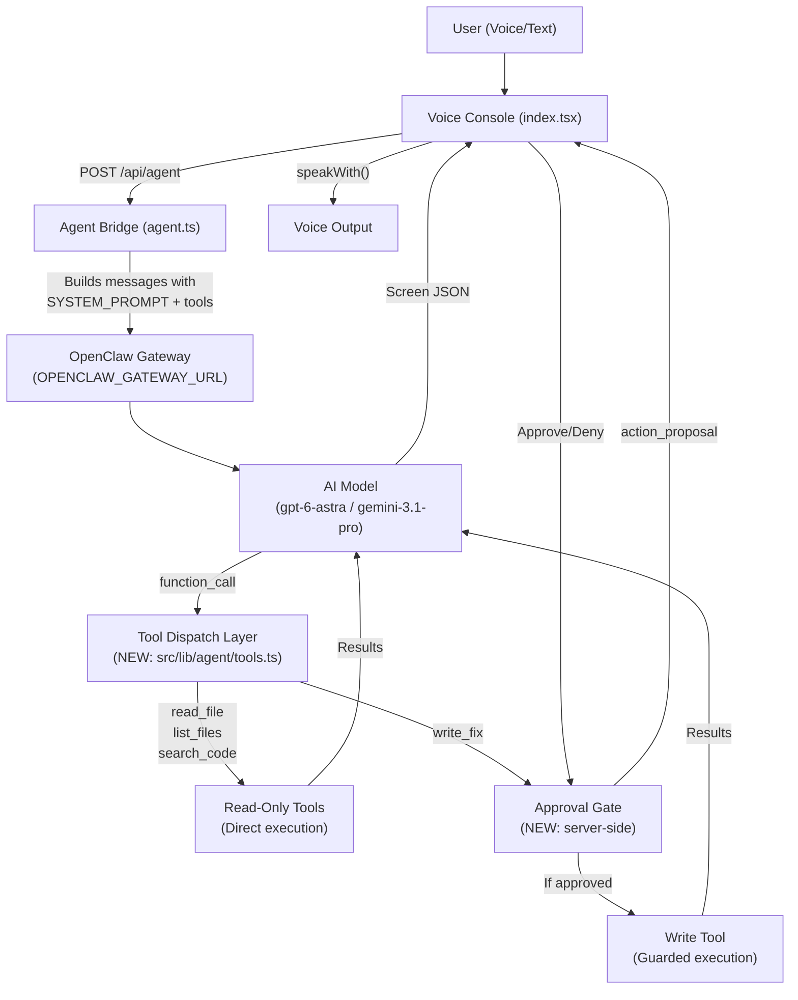

# Investigation Report — OpenClaw Voice Console Assignment

---

## 1. Executive Summary

The repository is a **fully working voice/chat/spatial console** built with TanStack Start + Vite + React 19 + Three.js/XR. It has hold-to-talk, hands-free standby, live step-by-step execution, a 3D WebXR room, Telegram-style bubbles, an approval panel, structured screen rendering, voice output (browser + Kokoro + cloud), and a planning/roadmap workflow.

**What it lacks is an actual AI agent with real tools.** The current system prompt ([prompt.ts](file:///d:/DarkCoders-OpenClaw-Assignment/DarkCoders-OpenClaw-Assignment/living-ai-talk/src/lib/voice/prompt.ts)) instructs the model to return structured screen JSON, but there are **no OpenClaw agent definitions, no skill files, no tool implementations, and no server-side tool execution layer**. The `openclaw/` folder contains only a placeholder README.

The assignment requires building a useful agent (or small team) on OpenClaw with real tools, real results, voice interaction, live visibility, and human approval for consequential actions.

**Recommended direction:** Build a **Code Security Reviewer** agent — it reads files from a workspace, reports findings, and proposes fixes that require approval before writing. This is feasible with 3–4 tools, fits the existing console contract perfectly, and avoids external service dependencies.

---

## 2. Assignment Requirements Checklist

| # | Requirement | Source | Status |
|---|------------|--------|--------|
| R1 | Agent with a clear purpose (solves a real problem) | ASSIGNMENT §1-2 | ❌ Missing — no agent definition or tools exist |
| R2 | OpenClaw integration | ASSIGNMENT §2, §5 | ❌ Missing — gateway.server.ts sends to a Lovable AI gateway, no OpenClaw agent/skill |
| R3 | Voice interaction (speak + hear) | ASSIGNMENT §2, §4 | ✅ Verified — hold-to-talk, standby, browser/Kokoro/cloud TTS all implemented |
| R4 | Real tools and skills (not simulated) | ASSIGNMENT §2-3, §7 | ❌ Missing — no tools defined; model returns structured text only |
| R5 | Live step-by-step execution visibility | ASSIGNMENT §3-4 | ✅ Verified — `RunStep[]` pipeline shown in `StepLog` component |
| R6 | Human approval for consequential actions | ASSIGNMENT §3, §Appendix | ⚠️ Partially implemented — UI panel exists, but approval decision is sent as a *text message* back to the model, **not enforced by a trusted execution layer** |
| R7 | Agent registration in `AGENTS` config | ASSIGNMENT §5 | ✅ Verified — `voice.ts` AGENTS roster, `getAgents()` merges custom agents |
| R8 | Structured screen responses (kind/screen/choices/navigation) | ASSIGNMENT Appendix | ✅ Verified — `parseScreen()` with strict validation, max 4 controls |
| R9 | Action proposals (action_proposal) | ASSIGNMENT Appendix | ⚠️ Partially — parser and UI panel exist, but no server-side execution or verification |
| R10 | `openclaw/` folder with agents and skills | ASSIGNMENT §9 | ❌ Missing — only placeholder README |
| R11 | README explaining what was built + AI usage | ASSIGNMENT §9 | ❌ Missing — current README is the starter template |
| R12 | No fake results | ASSIGNMENT §7 | N/A — no tools to fake yet |
| R13 | Secrets not in prompts or browser | ASSIGNMENT Appendix | ✅ Verified — keys stay server-side in `gateway.server.ts`, Vault lookup in `llm.ts` |
| R14 | `npm install && npm run typecheck && npm test && npm run dev` | ASSIGNMENT Appendix | ⚠️ Typecheck has 1 non-blocking error (`vaul` types); 12/12 tests pass; dev untested |

---

## 3. Repository Architecture Map

```
living-ai-talk/
├── ASSIGNMENT.md                           # Official brief
├── AGENTS.md                               # Lovable + project rules
├── README.md                               # Starter template
├── roadmap.md                              # Progress tracker
├── package.json                            # Vite 8 + TanStack Start + React 19
├── .env.example                            # OPENCLAW_GATEWAY_URL + model config
├── openclaw/
│   └── README.md                           # Placeholder — NO agents or skills
├── src/
│   ├── routes/
│   │   ├── index.tsx                       # ★ Main console (731 lines) — all lifecycle
│   │   ├── __root.tsx                      # Root layout
│   │   └── api/
│   │       ├── agent.ts                    # ★ Agent bridge → OpenClaw gateway
│   │       ├── llm.ts                      # Cloud provider proxy (OpenAI/Anthropic/Gemini/OpenRouter)
│   │       ├── transcribe.ts              # Speech-to-text proxy
│   │       └── speak.ts                   # Text-to-speech proxy
│   ├── lib/
│   │   ├── ai/
│   │   │   ├── gateway.server.ts          # Gateway URL, API key, constants
│   │   │   ├── models.ts                  # ★ Allowlisted models + resolveGatewayModel()
│   │   │   ├── models.test.ts             # 3 tests
│   │   │   ├── responses.server.ts        # SSE streaming (Responses API + chat/completions adapter)
│   │   │   ├── run-id.server.ts           # Lovable run ID tracking
│   │   │   ├── speech.server.ts           # TTS upstream
│   │   │   └── transcribe.server.ts       # STT upstream
│   │   ├── settings/
│   │   │   ├── voice.ts                   # ★ AGENTS roster, voice engine, speakWith()
│   │   │   ├── store.ts                   # ★ localStorage reactive store
│   │   │   ├── theme.ts                   # ★ CSS custom properties live theming
│   │   │   └── providers.ts               # Provider types, portfolio, BUILTIN
│   │   ├── voice/
│   │   │   ├── agent.ts                   # Client SSE reader, transcribeRecording(), streamAgentAnswer()
│   │   │   ├── prompt.ts                  # ★ SYSTEM_PROMPT, OUTPUT_FORMAT schema, planContextMessage()
│   │   │   ├── screen.ts                  # ★ parseScreen(), ActionProposal, paginate(), spokenScreen()
│   │   │   ├── speak.ts                   # Cloud TTS streaming playback
│   │   │   ├── record-wav.ts             # Microphone capture → WAV
│   │   │   ├── local-asr.ts              # Local Whisper transcription
│   │   │   ├── local-asr.test.ts         # 3 tests
│   │   │   └── providers-client.ts       # runProvider() — dispatches to built-in/local/cloud
│   │   ├── config/
│   │   │   ├── unified-plan.ts           # parsePlan(), exportRoadmap()
│   │   │   └── unified-plan.test.ts      # 3 tests
│   │   └── xr-room.ts + test            # Spatial pagination + 3 tests
│   ├── components/
│   │   ├── console-panels.tsx            # ★ Approval panel, lifecycle strip, waveform
│   │   ├── general-settings.tsx          # Settings dialog
│   │   ├── plan-builder.tsx              # Planning workflow
│   │   ├── telegram-run.tsx              # Bubbles, StepLog, InlineKeyboard, RunOptions
│   │   ├── xr-chat.tsx                   # WebXR room
│   │   └── ui/                           # Radix/shadcn primitives
│   └── config/
│       └── unified-plan.yaml             # 960-line architecture blueprint
```

---

## 4. Actual Application Flow

### 4.1 User input → Agent

1. **Hold-to-talk**: `startRecording()` → `recordWav()` → WAV file → `finishTurn(file)` → `transcribeRecording()` or `transcribeLocal()` — [index.tsx:274-306](file:///d:/DarkCoders-OpenClaw-Assignment/DarkCoders-OpenClaw-Assignment/living-ai-talk/src/routes/index.tsx#L274-L306)
2. **Text input**: `submitDraft()` → `sendText(text)` — [index.tsx:253-272](file:///d:/DarkCoders-OpenClaw-Assignment/DarkCoders-OpenClaw-Assignment/living-ai-talk/src/routes/index.tsx#L253-L272)
3. **Standby**: Auto-record on silence threshold — [index.tsx:389-404](file:///d:/DarkCoders-OpenClaw-Assignment/DarkCoders-OpenClaw-Assignment/living-ai-talk/src/routes/index.tsx#L389-L404)

### 4.2 Agent call

4. `runAgent()` → `runProvider(provider, turns, context, handlers, signal)` — [index.tsx:140-213](file:///d:/DarkCoders-OpenClaw-Assignment/DarkCoders-OpenClaw-Assignment/living-ai-talk/src/routes/index.tsx#L140-L213)
5. For the `builtin` provider: calls `streamAgentAnswer()` → `POST /api/agent` — [agent.ts](file:///d:/DarkCoders-OpenClaw-Assignment/DarkCoders-OpenClaw-Assignment/living-ai-talk/src/lib/voice/agent.ts#L61-L97)
6. `/api/agent` handler: resolves model via `resolveGatewayModel()`, builds input array with SYSTEM_PROMPT + plan context + turns (last 12), calls `streamResponses()` — [agent.ts:9-52](file:///d:/DarkCoders-OpenClaw-Assignment/DarkCoders-OpenClaw-Assignment/living-ai-talk/src/routes/api/agent.ts#L9-L52)
7. `streamResponses()` → proxies to `GATEWAY_BASE_URL/v1/responses` (for `openai/` models) or `GATEWAY_BASE_URL/v1/chat/completions` (for others), returns SSE stream — [responses.server.ts](file:///d:/DarkCoders-OpenClaw-Assignment/DarkCoders-OpenClaw-Assignment/living-ai-talk/src/lib/ai/responses.server.ts)

### 4.3 Response rendering

8. SSE events parsed on client: `response.reasoning_summary_text.delta` → reasoning panel; `response.output_text.delta` → live typing — [agent.ts:78-93](file:///d:/DarkCoders-OpenClaw-Assignment/DarkCoders-OpenClaw-Assignment/living-ai-talk/src/lib/voice/agent.ts#L78-L93)
9. Final text cleaned via `cleanRaw()`, then `parseScreen()` validates as structured screen OR falls back to plain text — [index.tsx:188-191](file:///d:/DarkCoders-OpenClaw-Assignment/DarkCoders-OpenClaw-Assignment/living-ai-talk/src/routes/index.tsx#L188-L191)
10. `app_commands` executed via `commandRef.current()` — [index.tsx:192-195](file:///d:/DarkCoders-OpenClaw-Assignment/DarkCoders-OpenClaw-Assignment/living-ai-talk/src/routes/index.tsx#L192-L195)
11. `screen.text` spoken via `speakWith()` → browser / Kokoro / cloud — [index.tsx:204-211](file:///d:/DarkCoders-OpenClaw-Assignment/DarkCoders-OpenClaw-Assignment/living-ai-talk/src/routes/index.tsx#L204-L211)

### 4.4 Approval handling

12. If `screen.actionProposal` is present, it's stored in the message — [index.tsx:196-198](file:///d:/DarkCoders-OpenClaw-Assignment/DarkCoders-OpenClaw-Assignment/living-ai-talk/src/routes/index.tsx#L196-L198)
13. `LifecyclePanel` displays proposal with Approve/Deny buttons — [console-panels.tsx:171-183](file:///d:/DarkCoders-OpenClaw-Assignment/DarkCoders-OpenClaw-Assignment/living-ai-talk/src/components/console-panels.tsx#L171-L183)
14. **Critical finding**: Approval/denial is handled by calling `sendText()` with a text message like `"Approved action [act_01]..."` — [index.tsx:672-678](file:///d:/DarkCoders-OpenClaw-Assignment/DarkCoders-OpenClaw-Assignment/living-ai-talk/src/routes/index.tsx#L672-L678)
15. **This means there is NO server-side enforcement.** The "approval" is just a user message sent back to the model. The model decides whether to claim execution. There is no trusted execution layer that verifies the decision.

---

## 5. OpenClaw and Agent Integration Findings

| Aspect | Finding | Status |
|--------|---------|--------|
| Gateway URL | `OPENCLAW_GATEWAY_URL` env var → `gateway.server.ts` | ✅ Verified |
| Default | `http://localhost:18789` | Verified in code |
| API key | `OPENCLAW_API_KEY` env var → `getApiKey()` → Bearer header | ✅ Verified |
| Protocols | `/v1/responses` (OpenAI models), `/v1/chat/completions` (others) | ✅ Verified |
| Streaming | SSE with `response.output_text.delta` / `response.reasoning_summary_text.delta` | ✅ Verified |
| Model routing | `resolveGatewayModel()` enforces allowlist; unknown → null → 400 error | ✅ Verified + tested |
| Agent definitions | **NONE** — `openclaw/` has only a placeholder README | ❌ Missing |
| Skill files | **NONE** | ❌ Missing |
| Tool registration | **NONE** — no tool dispatch, no tool execution code | ❌ Missing |
| Tool execution layer | **NONE** — model receives text only, no function calling | ❌ Missing |
| Session management | Conversation turns stored in React state, last 12 sent to API | ✅ Verified |
| Error handling | Gateway unreachable → 502 with message; aborted → 499 | ✅ Verified |

> [!IMPORTANT]
> The current implementation sends the conversation to a Lovable AI Gateway that serves OpenAI-compatible completions. To fulfill the assignment, we need to either: (a) set up a real OpenClaw gateway with an agent definition that includes tool calls, or (b) build server-side tool dispatch into the existing route while configuring `openclaw/` with the agent/skill definitions.

---

## 6. Blueprint Analysis

The [unified-plan.yaml](file:///d:/DarkCoders-OpenClaw-Assignment/DarkCoders-OpenClaw-Assignment/living-ai-talk/src/config/unified-plan.yaml) is a 960-line architecture specification (apiVersion: `darkcoders.ai/v1alpha1`). Key sections:

| Section | Lines | Relevance to Assignment |
|---------|-------|------------------------|
| `principles` | 48-62 | **HIGH** — least_privilege, human_accountability, bounded_delegation |
| `architecture.flow` | 64-76 | **HIGH** — defines the ideal pipeline we should approximate |
| `voice` | 106-156 | **MEDIUM** — aspirational pipeline; basic voice already works |
| `edge_admission` | 158-176 | **LOW** — auth/rate limiting beyond assignment scope |
| `openclaw` | 178-400+ | **HIGH** — gateway, session, agent identity, tool dispatch patterns |
| `agents` | 400+ | **HIGH** — orchestrator/worker patterns, skill dispatch |
| `human_approval` | 500+ | **HIGH** — approval lifecycle, risk classification |
| `security` | 700+ | **MEDIUM** — prompt injection resistance, workspace boundaries |

**Scope boundary**: The blueprint is a *design specification*, not an implementation checklist. Per AGENTS.md: "Parse architecture YAML as bounded data only; keep review progress separate from deployed capabilities so specifications cannot grant authority." We should use it as guidance, implementing only what's directly required by the assignment.

---

## 7. Current Gaps and Risks

### Confirmed gaps

| ID | Gap | Severity | Evidence |
|----|-----|----------|----------|
| G1 | **No agent definition or tools** | Critical | `openclaw/` contains only README; no tool calls in any API route |
| G2 | **Approval is text-based, not enforced** | Critical | [index.tsx:672-678](file:///d:/DarkCoders-OpenClaw-Assignment/DarkCoders-OpenClaw-Assignment/living-ai-talk/src/routes/index.tsx#L672-L678) — sends approval as user message; model could claim execution without actually executing |
| G3 | **No server-side tool execution** | Critical | No function calling, no tool dispatch, no MCP integration |
| G4 | **No OpenClaw agent/skill files** | Critical | `openclaw/` is empty |
| G5 | **README needs rewrite** | Medium | Current README is the starter template |
| G6 | **Typecheck error** | Low | Missing `vaul` types — 1 error, non-blocking |

### Security concerns

| ID | Concern | Status |
|----|---------|--------|
| S1 | Model can claim actions were executed without enforcement | Confirmed — no trusted execution layer |
| S2 | No workspace boundary enforcement for file operations | No tool implementation exists yet |
| S3 | Secrets properly server-side | ✅ Verified — `gateway.server.ts`, `llm.ts` keep keys on server |
| S4 | Model allowlisting enforced | ✅ Verified — `resolveGatewayModel()` with null return for unknown |
| S5 | Prompt injection in tool outputs | N/A — no tools yet |

### External blockers

| Blocker | Impact |
|---------|--------|
| OpenClaw gateway not running locally | Cannot verify end-to-end agent execution |
| No API key configured | Cannot test cloud model responses |
| No Whisper/Kokoro server | Voice input/output limited to browser native |

---

## 8. Candidate Ideas and Final Recommendation

### Comparison

| Criterion | A: Code Security Reviewer | B: Research Assistant | C: File Organizer |
|-----------|--------------------------|----------------------|-------------------|
| Real problem | Reviews code for vulnerabilities | Searches/summarizes web content | Organizes local files |
| Voice value | "Scan this file for issues" → spoken summary | "What is X?" → summary | "Move these files" |
| Tools needed | `read_file`, `list_files`, `search_code`, `write_fix` | `web_search`, `summarize` | `list_dir`, `move_file`, `rename_file` |
| External deps | None (local filesystem) | Web search API required | None |
| Approval fit | Write/fix operations need approval; reads are direct | No writes = weak approval story | All moves need approval = good fit |
| Demonstrability | Strong (scan → findings → proposed fix → approve → apply) | Medium (search → summarize) | Medium |
| Security fit | Directly aligns with CISO agent persona already in roster | Generic | Generic |
| Differentiation | High — not a chatbot, does real analysis | Medium | Low |
| Implementation effort | Medium (3-4 tools + analysis prompt) | High (needs search API) | Low but boring |
| Risk of over-engineering | Low | Medium (RAG temptation) | Low |

### Recommendation: **A — Code Security Reviewer**

**Why:**
1. **Fits the existing architecture perfectly** — the CISO agent is already registered in the roster, the approval panel is built for exactly this kind of workflow
2. **No external dependencies** — reads local files, uses the model's knowledge for analysis
3. **Strong approval story** — reads are direct, proposed fixes require human approval
4. **Demonstrates real work** — scans actual code, produces real findings, proposes real fixes
5. **Natural voice interaction** — "Review my auth module" → spoken findings → "Apply the fix?" → Approve
6. **Weekend-sized** — 3-4 tools, one agent, focused scope

### Agent: `ciso` (Code Security Reviewer)
- **Read-only tools**: `read_file`, `list_files`, `search_code`
- **State-changing tool**: `write_fix` (requires approval)
- **Scope**: Files within a configured workspace directory

---

## 9. Proposed Architecture



### Key components (proposed new files)

| File | Purpose | Status |
|------|---------|--------|
| `openclaw/agents/ciso.yaml` | Agent definition with tools and persona | **New** |
| `openclaw/skills/code-review/` | Security analysis skill definition | **New** |
| `src/lib/agent/tools.ts` | Tool implementations (read_file, list_files, search_code, write_fix) | **New** |
| `src/lib/agent/approval.ts` | Server-side approval record store with action binding | **New** |
| `src/routes/api/agent.ts` | **Modified** — add tool dispatch loop after model response | Existing |

### Trust boundary

| Layer | Responsibility |
|-------|---------------|
| Model | Propose tool calls; cannot execute directly |
| Tool Dispatch | Validate tool name against allowlist; validate arguments |
| Approval Gate | Block state-changing tools; create server-side action record |
| Execution Layer | Verify approval decision matches action record; execute; return real result |
| Response | Report actual outcome or real error |

---

## 10. Requirements Traceability Matrix

| Req | Description | Existing Code | Proposed Change | Verification |
|-----|-------------|---------------|-----------------|-------------|
| R1 | Agent with clear purpose | `voice.ts` AGENTS roster | Add CISO security reviewer definition + OpenClaw config | Agent responds to security queries with real results |
| R2 | OpenClaw integration | `gateway.server.ts`, `responses.server.ts` | Add tool calling support in agent route; populate `openclaw/` | End-to-end tool execution through gateway |
| R3 | Voice interaction | Full pipeline verified | No change needed | Voice in → analysis → spoken findings |
| R4 | Real tools | None | Implement read_file, list_files, search_code, write_fix | Tool returns real file contents / search results |
| R5 | Live visibility | `StepLog`, `RunStep[]` pipeline | Add tool-call steps to step log | Tool activity visible during execution |
| R6 | Human approval | UI panel exists, text-based | Add server-side action records, verify before execution | Denied action confirmed not executed |
| R7 | Agent registration | `AGENTS` in voice.ts | Extend with proper CISO persona | Agent appears in console + 3D room |
| R8 | Structured screens | `parseScreen()`, `OUTPUT_FORMAT` | No change needed | Verified by existing tests |
| R9 | Action proposals | Parser + UI exist | Add server-side creation + verification | Proposals display; approval/denial flows correctly |
| R10 | openclaw/ folder | Empty | Populate with agent YAML, skill definitions | Folder contains runnable configuration |
| R11 | README | Template | Rewrite completely | Covers all 17 required sections |
| R12 | No fake results | N/A | Ensure tools return real data only | Test with real files, verify actual content returned |
| R13 | Secrets secure | Verified server-side | No change needed | Secrets never in prompts or client |
| R14 | npm scripts work | 12/12 pass, 1 type error | Fix vaul types | typecheck clean, all tests pass |

---

## 11. Detailed End-to-End Implementation Plan

### Stage 0: Baseline Safety (~15 min)
- **Tasks**: Verify git status (clean, 1 untracked file `prompt.md`), document baseline tests (12/12 pass), fix `vaul` typecheck error
- **Files**: `package.json` (add `@types/vaul` if exists, or add `.d.ts`)
- **Acceptance**: `npm run typecheck` clean, `npm test` 12/12 pass
- **Risk**: Low

### Stage 1: OpenClaw Agent & Skill Definitions (~1 hour)
- **Tasks**: Create `openclaw/agents/ciso.yaml` with agent definition, persona, model, tool list. Create `openclaw/skills/code-review/` with skill metadata.
- **Files**: `openclaw/agents/ciso.yaml`, `openclaw/skills/code-review/skill.yaml`, `openclaw/gateway.yaml`
- **Acceptance**: Valid YAML, consistent with assignment contract
- **Risk**: OpenClaw schema is not fully documented in repo; may need to match conventions from their docs

### Stage 2: Tool Implementations (~2 hours)
- **Tasks**: Implement 4 tools in `src/lib/agent/tools.ts`:
  - `read_file` — reads a file within workspace, returns content (read-only)
  - `list_files` — lists files in workspace directory (read-only)
  - `search_code` — greps for pattern in workspace (read-only)
  - `write_fix` — writes a proposed fix to a file (state-changing, requires approval)
- **Security**: Workspace boundary enforcement (path traversal prevention), file size limits, binary detection
- **Files**: `src/lib/agent/tools.ts` (new), `src/lib/agent/tools.test.ts` (new)
- **Acceptance**: Unit tests for each tool, path traversal blocked, workspace boundary enforced
- **Dependencies**: None

### Stage 3: Server-Side Approval Enforcement (~1.5 hours)
- **Tasks**: Create `src/lib/agent/approval.ts` with:
  - In-memory action record store (keyed by proposal ID)
  - `createProposal()` — stores action + arguments
  - `resolveProposal(id, approved)` — marks decision, returns action only if approved
  - `executeApproved(id)` — executes only if verified approved + matches original
- **Modify** `/api/agent` to handle tool calls and approval flow
- **Files**: `src/lib/agent/approval.ts` (new), `src/lib/agent/approval.test.ts` (new)
- **Acceptance**: Denied proposals cannot execute; duplicate submissions rejected; arguments cannot change after approval
- **Risk**: Medium — must integrate with existing SSE streaming

### Stage 4: Agent Route Enhancement (~1.5 hours)
- **Tasks**: Modify `src/routes/api/agent.ts` to:
  - Support function calling in the model request
  - Implement a tool-call loop: receive tool_call → dispatch to tool → return result → continue
  - Emit step events for each tool call
  - Emit action_proposal for state-changing tools
  - Handle approval response in subsequent request
- **Files**: `src/routes/api/agent.ts` (modify)
- **Acceptance**: Model can call tools, results returned, approval blocks write_fix
- **Dependencies**: Stages 2, 3

### Stage 5: Agent Registration & Persona (~30 min)
- **Tasks**: Update AGENTS roster in `voice.ts` with refined CISO persona, add new model to allowlist in `models.ts` if needed
- **Files**: `src/lib/settings/voice.ts` (modify), `src/lib/ai/models.ts` (modify if needed)
- **Acceptance**: CISO agent selectable in console and 3D room

### Stage 6: Response & Voice Integration (~1 hour)
- **Tasks**: Ensure tool-call steps appear in `StepLog`, final screen.text is speakable, approval proposals display correctly in the `LifecyclePanel`
- **Files**: `src/routes/index.tsx` (modify approval handler to use server-side verification)
- **Acceptance**: Full voice interaction cycle works: speak → transcribe → agent → tools → approval → speak findings

### Stage 7: Testing & Robustness (~1.5 hours)
- **Tasks**: Add tests for tools, approval, path traversal, model resolution, error cases. Ensure all 12 existing + new tests pass.
- **Files**: Various test files
- **Acceptance**: 20+ tests pass, key security scenarios covered

### Stage 8: Documentation & Packaging (~1 hour)
- **Tasks**: Rewrite README.md with all 17 sections. Finalize `openclaw/` folder. Document AI tool usage.
- **Files**: `README.md`, `openclaw/README.md`
- **Acceptance**: Reviewer can follow setup instructions end-to-end

### Estimated total: ~10 hours (fits "focused half-day" core + polish)

---

## 12. Testing and Acceptance Plan

### Functional Tests

| Test | Input | Expected | Method |
|------|-------|----------|--------|
| Agent registration | Select CISO from dropdown | Agent appears, persona loaded | Manual + unit |
| read_file tool | "Read the package.json" | Returns real file content | Unit + integration |
| list_files tool | "List files in src/lib" | Returns real directory listing | Unit + integration |
| search_code tool | "Search for getApiKey" | Returns real grep results | Unit + integration |
| write_fix tool (denied) | Propose fix → Deny | File NOT modified | Unit + integration |
| write_fix tool (approved) | Propose fix → Approve | File written with exact content | Unit + integration |
| Structured screen | Agent returns screen JSON | Choices rendered, text spoken | Manual |
| Plain text fallback | Local model returns text | Displayed as-is | Unit (existing) |
| Pagination | Long response | Pages with Previous/Next | Unit (existing, 12/12) |

### Security Tests

| Test | Input | Expected |
|------|-------|----------|
| Path traversal | `read_file("../../etc/passwd")` | Rejected, error returned |
| Workspace escape | `list_files("/root")` | Rejected, error returned |
| Unknown tool | Tool call for `exec_shell` | Rejected |
| Forge approval | Send approval text without proposal | No execution |
| Duplicate approval | Approve same proposal twice | Second ignored |
| Modified arguments | Change file path after approval | Rejected |
| Binary file read | `read_file("image.png")` | Rejected or truncated |

### Error Tests

| Test | Expected |
|------|----------|
| Gateway unreachable | 502 error with clear message |
| Missing API key | 400 error |
| Model timeout | Honest error surfaced |
| Empty file | Tool returns empty content honestly |
| File not found | Tool returns "file not found" error |

---

## 13. Risks, Dependencies, and Blocking Questions

### Risks

| Risk | Impact | Mitigation |
|------|--------|-----------|
| OpenClaw gateway format unknown | Cannot verify agent YAML schema | Document as "proposed", validate at runtime |
| No local gateway for testing | Cannot test end-to-end OpenClaw flow | Test tool dispatch independently; mock gateway |
| Tool calling protocol varies by model | Function calls may not work with all gateway models | Use OpenAI-compatible tool calling, test with one model |

### Dependencies

| Dependency | Status | Needed For |
|------------|--------|-----------|
| OpenClaw Gateway running | ❓ Unknown | End-to-end agent execution |
| `OPENCLAW_GATEWAY_URL` configured | ❓ Not set | API calls |
| API key for chosen model | ❓ Not set | Model responses |
| Node.js runtime | ✅ Available | Test and dev server |
| npm packages installed | ✅ Installed | Build and run |

### Blocking Questions

1. **Do you have an OpenClaw gateway available, or should I design the agent route to work with a standard OpenAI-compatible endpoint that we can later point at OpenClaw?** (This affects how tool calling is implemented — native OpenClaw tool dispatch vs. OpenAI function calling.)

2. **Is there a preferred workspace directory for the security reviewer to scan, or should I default to the repository itself?** (This sets the sandbox boundary.)

3. **Do you already have a preferred AI model and API key configured, or should I set up the system to work with any of the allowlisted models?** (Affects testing strategy.)

---

## 14. Deliverables Checklist

| # | Deliverable | Status |
|---|------------|--------|
| D1 | Application code (modified `agent.ts`, new tools, approval layer) | Not started |
| D2 | `openclaw/agents/ciso.yaml` | Not started |
| D3 | `openclaw/skills/code-review/` | Not started |
| D4 | `openclaw/gateway.yaml` | Not started |
| D5 | README.md (complete rewrite) | Not started |
| D6 | Test suite (tools, approval, security) | Not started |
| D7 | All existing tests still pass | ✅ Currently 12/12 |
| D8 | Typecheck clean | ⚠️ 1 error (fixable) |
| D9 | No secrets committed | ✅ Verified |
| D10 | Demonstration script | Not started |

---

## 15. Approval Gate

### Recommended approach
Build a **Code Security Reviewer** agent (`ciso`) with 4 tools (`read_file`, `list_files`, `search_code`, `write_fix`), server-side approval enforcement for write operations, and proper OpenClaw agent/skill definitions.

### Highest-priority first stage
**Stage 0** — establish baseline safety (fix typecheck, confirm all tests pass).

### Assumptions needing confirmation
1. An OpenClaw gateway (or OpenAI-compatible endpoint) will be available for testing
2. The repository's own files are an acceptable workspace for the security reviewer to scan
3. The OpenClaw agent YAML format follows the structure outlined in `openclaw/README.md`

### Questions requiring your answer
1. **OpenClaw gateway availability** — do you have one running, or should I build the tool dispatch within the existing app server?
2. **Workspace scope** — may the agent scan this repository's own files?
3. **Model/key availability** — which model should I target for testing?

> [!IMPORTANT]
> **I will not begin implementation until you explicitly approve this plan.** Please review the proposed architecture, agent concept, and implementation roadmap, answer the blocking questions, and confirm I should proceed with Stage 0.
